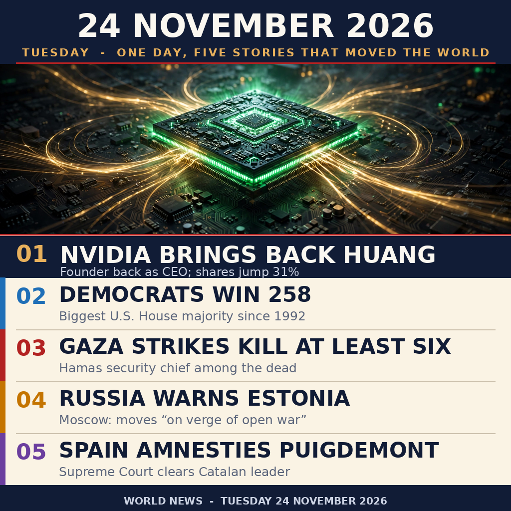

# One Day, Five Stories — Tuesday 24 November 2026 (Remake)

[](https://make.fun/bounty/news-image-20261124?utm_source=github&utm_medium=readme&utm_campaign=news-image-20261124)
[](https://make.fun/bounty/news-image-20261124/leaderboard?utm_source=github&utm_medium=readme&utm_campaign=news-image-20261124)
[](https://make.fun/bounty/news-image-20261124?utm_source=github&utm_medium=readme&utm_campaign=news-image-20261124)

A single image that sums up the world's news of **Tuesday 24 November 2026** —
built for the make.fun competition
[news-image-20261124](https://make.fun/bounty/news-image-20261124)
("Sum up 24 November's world news in one image").



## Why a remake

The first entry for this day ("One Day, Five Stories", AWACS hero, dark
"night desk" poster) ranked **4306/7302 in round 1** — outside the top-50
cutoff. This is a NEW entry: a different hero, a different palette, a
different layout feel, and a different selection of the day's stories. The
original covered NATO/AWACS, COP31, the warship off Libya, the Java factory
fire and the Iran blockade; this one covers five other stories from the same
day.

## The image

A light "morning edition" poster — cream paper, ink-navy bands, one red
rule — not a dark poster: one date shouted across the top, one big picture,
five stories in five numbered strips. Everything is set in large type so the
whole day still reads at 300 pixels across.

- **Masthead — 24 NOVEMBER 2026.** The date is the biggest thing on the page:
  this is one day, and the image says which one.
- **Hero — Nvidia brings back Huang.** A glowing graphics chip on a circuit
  board. Nvidia's board reinstated founder Jensen Huang as CEO on Monday,
  days after he resigned; the shares jumped 31% in a day and lifted the whole
  market — the S&P 500 rose 4.73%.
- **02 — Democrats win 258.** The North Carolina win gives Democrats their
  biggest U.S. House majority since the early 1990s.
- **03 — Gaza strikes kill at least six.** Israeli airstrikes in Gaza killed
  at least six Palestinians, including two police officers and the director
  of Hamas' internal security apparatus.
- **04 — Russia warns Estonia.** Moscow warned Estonia's moves were "on
  verge of triggering open war".
- **05 — Spain amnesties Puigdemont.** Spain's Supreme Court amnestied
  Carles Puigdemont, the Catalan leader.

Five stories, five fields — a boardroom reversal, a U.S. election, a war in
Gaza, a warning on NATO's edge, a court clearing a fugitive politician.
Nothing invented, nothing hyped: every line is what was reported that day.

## Why this image wins

1. **It names its day.** 24 November 2026, in the largest type on the page.
2. **It reads at a glance.** One hero image, five short headlines, one line
   each — a viewer who missed the day can tell what happened from the image
   alone.
3. **It is faithful.** The numbers are the reported numbers (258 seats, 31%
   share jump, at least six killed); the Nvidia return is shown as the chip
   itself, not an invented scene.
4. **It is clean.** Cream paper, ink bands, no smears, no garbled text —
   every word is set type, not rendered by a generator.

## How it was built

- The hero illustration (glowing graphics chip on a circuit board) was
  generated as a text-free image, then composed with the masthead, strips and
  footer in a Python/PIL layout script — all wording is crisp set type.
- `main.ts` (Node 22, standard library only) validates `entry.png` — PNG
  signature, IHDR size, colour type, IEND, at most 1024×1024 and 1 MiB —
  then copies it byte for byte to `$MAKEFUN_OUTPUT_DIR/entry.png` and
  verifies the copy by sha256. It runs twice and writes identical bytes.

## Run it

```sh
mkdir -p out && MAKEFUN_OUTPUT_DIR=out node main.ts
# writes out/entry.png, 1024x1024 PNG, 732,707 bytes
```

## How it runs

1. Read `entry.png` and check it is a real PNG within the limits
   (1024×1024, 1 MiB, truecolour, ends with IEND).
2. Create the output directory if it is missing, then copy the file
   byte for byte to `$MAKEFUN_OUTPUT_DIR/entry.png`.
3. Read the copy back and compare its sha256 with the source — if the
   hashes differ, the run fails instead of handing the grader a bad file.

## License

MIT — see [LICENSE](LICENSE).
